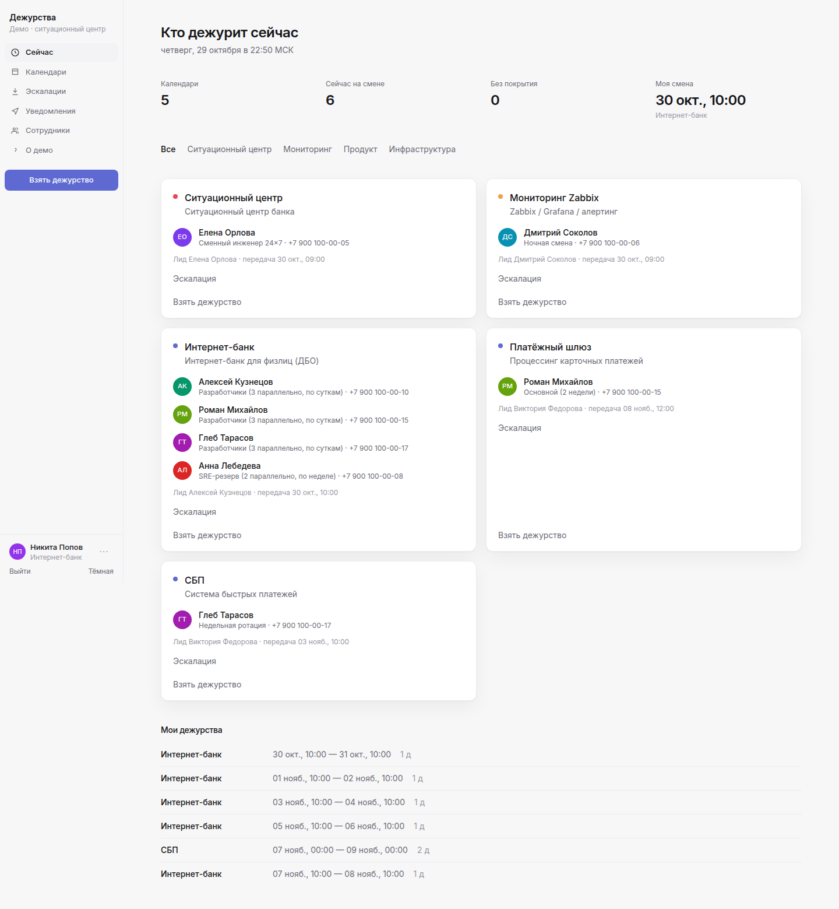
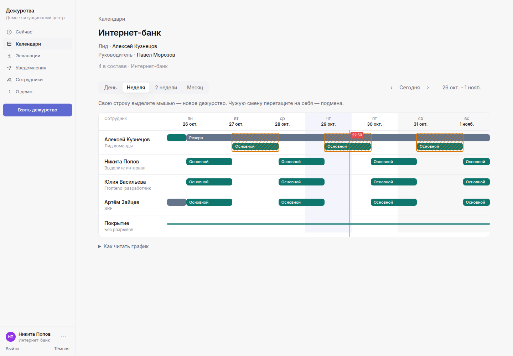
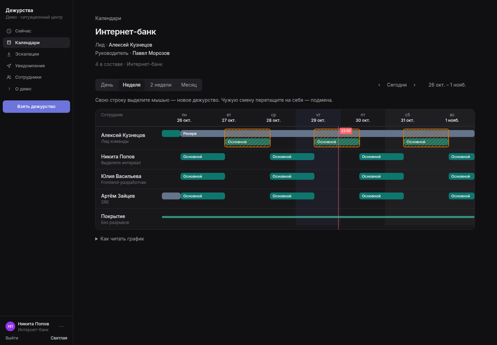
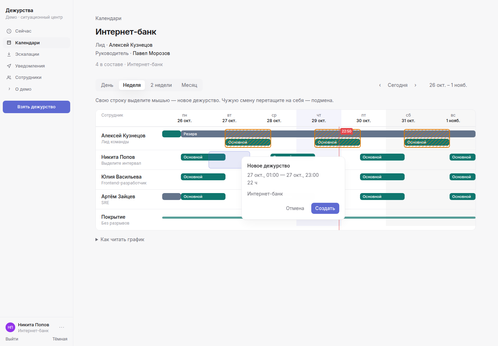
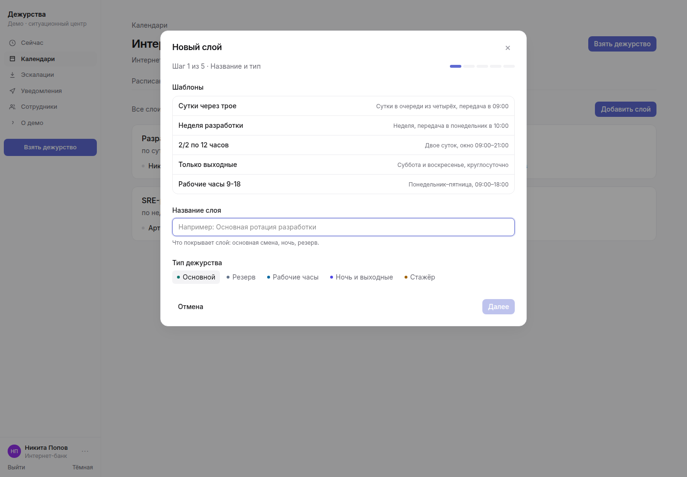

# Сервис дежурств — демо-стенд (frontend-only)

Демо централизованного сервиса дежурств для ситуационного центра и дежурной службы мониторинга банка.
Бэкенда нет: данные замоканы и хранятся в localStorage браузера. SSO и Telegram — имитация.

## Как открыть
- Без сервера: двойной клик по `oncall-demo.html` (один самодостаточный файл).
- Dev: `npm install && npm run dev`
- Сборка: `npm run build` → `dist/`, `npm run preview` (порт 4173)
- Один HTML: `npm run build:single` → `oncall-demo.html`
- Smoke-тест (нужен Chrome): `node smoke.mjs [url]`

## Экраны
Вход через корпоративный SSO (мок) · Кто дежурит сейчас · Календари и команды · Календарь: таймлайн 1/2/4 недели и месяц, слои, эскалация, взятые дежурства, настройки · Мастер слоя с шаблонами ротации · Таймлайн команды · «Взять дежурство» · Эскалации и симуляция инцидента · Уведомления Telegram (мок) · Сотрудники · О демо / OneUptime.

Светлая и тёмная тема переключаются внизу боковой панели и сохраняются в браузере.

## Таймлайн команды
В списке календарей откройте «Команды» — например, «Интернет-банк». На таймлайне по человеку видны все смены (день, неделя, две недели, месяц): цвет полосы — тип дежурства, штриховка — пересечение, розовый фон — дыра в покрытии. Сверху — лид и руководитель.

Свою строку можно выделить мышью и подтвердить новое дежурство. Чужую смену перетащите на себя — это подмена. Оба действия пишут сообщение в журнал Telegram.

## Шаблоны ротации
В мастере слоя один клик заполняет ротацию и часы: «Сутки через трое», «Неделя разработки», «2/2 по 12 часов», «Только выходные», «Рабочие часы 9-18».

## Что взято из OneUptime
Schedules → Layers (rotation every N day/week, starts at, hand-off time, restriction times daily/weekly, упорядоченные участники, приоритет слоёв), Overrides, Final schedule, On-Call Duty Policy с Escalation Rules (escalate after N min, repeat policy, ack останавливает), «Next in rotation», один цвет на человека.
Добавлено: роль лида группы, руководитель дежурного из оргструктуры, N человек одновременно в слое, режим «все слои параллельно», самозапись «Взять дежурство», типы календарей и дежурств, таймлайн команды и шаблоны смен.

## Скриншоты

Дашборд.

Таймлайн команды, светлая тема.

Таймлайн команды, тёмная тема.

Создание дежурства протягиванием по своей строке.

Шаблоны в мастере слоя.

