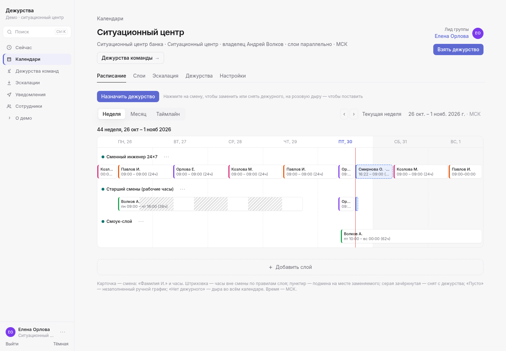
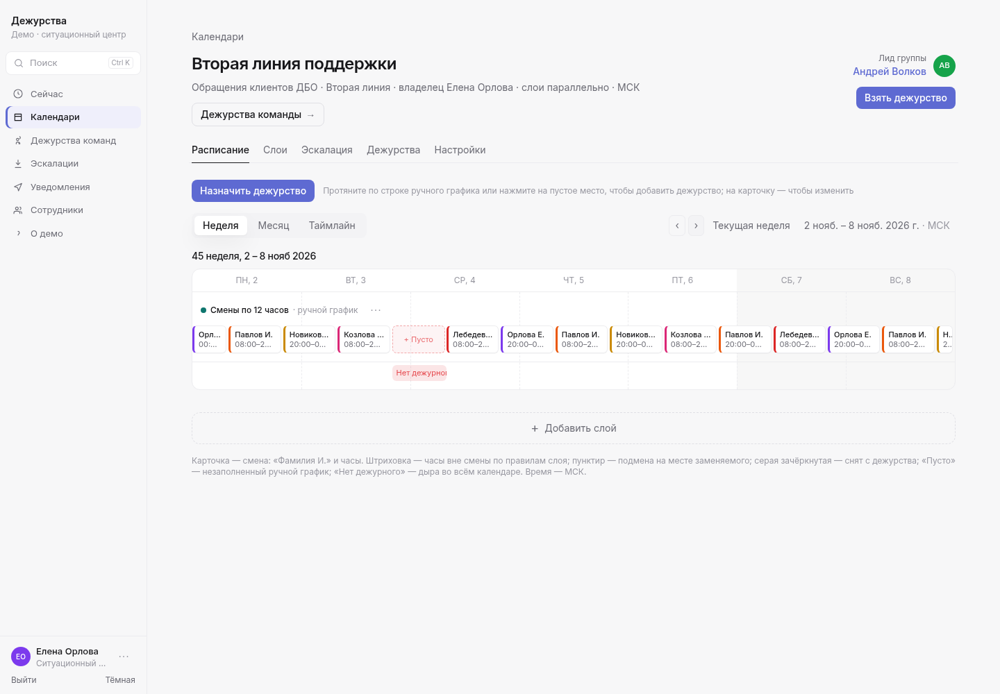

# Сервис дежурств — демо-стенд (frontend-only)

Демо централизованного сервиса дежурств для ситуационного центра и дежурной службы мониторинга банка.
Бэкенда нет: данные замоканы и хранятся в localStorage браузера. SSO и Telegram — имитация.

## Как открыть
- GitHub Pages: https://heimrdal.github.io/duty-demo/ (сайт появится после однократного включения Pages → GitHub Actions в настройках репозитория; у автоматизации нет права включить его самой)
- Без сервера: двойной клик по `oncall-demo.html` (один самодостаточный файл).
- Dev: `npm install && npm run dev`
- Сборка: `npm run build` → `dist/`, `npm run preview` (порт 4173)
- Один HTML: `npm run build:single` → `oncall-demo.html`
- Тесты: `npm test`; под четырьмя поясами (UTC, Москва, Берлин, Владивосток): `npm run test:tz`
- Smoke-тест (нужен Chrome): `node smoke.mjs [url]`

Публикация на Pages: при пуше в `main` workflow `.github/workflows/pages.yml` собирает `dist` и выкладывает его. В Vite `base` равен `./`, поэтому сборка открывается и с подпути `/duty-demo/`.

## Экраны
Вход через корпоративный SSO (мок) · Кто дежурит сейчас · Календари и команды · Календарь: расписание по неделям (неделя / месяц / таймлайн), слои, эскалация, взятые дежурства, настройки · Мастер слоя: ротация по шаблону или ручной график · Дежурства команды · «Взять дежурство» · Эскалации и симуляция инцидента · Уведомления Telegram (мок) · Сотрудники · О демо / OneUptime.

Светлая и тёмная тема переключаются внизу боковой панели и сохраняются в браузере.

## Сотни команд
- **Поиск** — Ctrl+K (⌘K на Mac) или поле «Поиск» в боковой панели. Ищет команды, календари, людей (имя, @telegram, телефон) и системы. У календаря и команды сразу видно, кто дежурит, с кнопками «Позвонить» и «Скопировать номер»; у человека — где он дежурит сейчас. Стрелки — выбор, Enter — открыть, Shift+Enter — скопировать номер дежурного, Esc — закрыть.
- **Главная.** Когда календарей до 8, всё как раньше — карточки. Когда больше: «Избранное» (звёздочка, хранится отдельно для каждого пользователя), «Мои команды» и компактный список всех календарей с поиском, фильтрами («без покрытия», подразделение) и страницами по 20. «Сейчас без покрытия» показывает число и ссылку «Показать».
- **Команды и Сотрудники** сгруппированы по подразделениям (сворачиваются), со счётчиками и поиском. Состав и оргструктура в банке приходят из LDAP.
- **Выбор сотрудника** во всех формах — поиск по имени, @telegram, подразделению и должности; люди из команды календаря идут первыми.
- **Демо-набор**: «6 команд / 300 команд» — на экране входа и в «О демо». Большой набор — ~300 календарей, ~1500 сотрудников, 25 подразделений, генерируется детерминированно. Переключение сбрасывает локальные изменения.

- **Поиск календарей** («Календари» и «Все календари» на главной) ищет по названию календаря, названию команды, системе и подразделению.
- **Создание календаря и мастер слоя** не блокируют кнопку молча: при нажатии видно «Заполните: …», незаполненные поля подсвечены красным (`aria-invalid`), фокус — на первом из них.

## Дежурства команды
В боковой панели откройте «Дежурства команд» — например, «Интернет-банк». Из шапки календаря туда же ведёт кнопка «Дежурства команды». На таймлайне по человеку видны все смены (день, неделя, две недели, месяц).

### Настроить дежурства с экрана команды
- Лид, владелец календаря и руководители по оргструктуре видят на экране команды действия. Без календаря — пустое состояние «У команды пока нет дежурств» и кнопка «Настроить дежурства»: она создаёт календарь команды (команда и лид подставлены) и сразу открывает мастер графика. Если календарь есть — «Изменить график» (вкладка графиков календаря; при нескольких календарях — меню) и «Ещё календарь».
- Мастер спрашивает «С какой даты команда начинает дежурить?» — по умолчанию ближайшая передача смены; дату в прошлом мастер подсвечивает. До старта календарь показан серым «ещё не запущено» — это не дыра и не попадает в «Сейчас без покрытия».
- На последнем шаге мастера — пересечения с другими дежурствами тех же людей на 4 недели: кто, когда, в каком календаре и графике. Сохранить можно, с предупреждением.
- После сохранения открывается «Проверка перед запуском»: участники и дата старта, дыры на 4 недели, пересечения, эскалация по уровням, каналы уведомлений и открытые вопросы. «График сохранён» и «Готовность проверена» — разные отметки; после изменения графика или эскалации проверку нужно подтвердить заново.
- Основное действие в календаре — «Добавить график дежурств». Несколько графиков в календаре — это его слои; настройка их сочетания (параллельно / по приоритету) появляется, только когда графиков два и больше.

Цвет полосы — человек, белая штриховка с пунктирной рамкой — подмена, оранжевая рамка со значком «!» — две смены одного человека сразу, розовая плашка «Нет дежурного» — в этот час никто не назначен. Клик или фокус с клавиатуры на смене открывает карточку: ФИО, календарь, слой, начало и конец, часовой пояс. Счётчик «Сейчас без покрытия» на главной считает только текущий момент, а не всё окно таймлайна. Сверху — лид календаря и руководитель лида. В эскалации руководитель — это руководитель того, кто дежурит.

Свою строку можно выделить мышью: разовое дежурство встаёт на целые сутки от времени передачи смены и не создаётся в прошлом. Чужую смену перетащите на себя — это подмена.

Подмена стоит в строке слоя на месте заменяемого: штриховка, пометка «подмена» и подсказка «вместо …» — в недельном расписании, на таймлайне календаря и в «Дежурствах команды». Отдельная строка «Разовые дежурства» появляется, только когда есть настоящие разовые дежурства. Типы дежурства — только «Основной» и «Резерв»; у календарей типа больше нет (старые данные мигрируют: бизнес, ночь, теневой → основной). Оба действия пишут сообщение в журнал Telegram.

## Часовые пояса
У каждого календаря свой пояс (по умолчанию Europe/Moscow, меняется в «Настройках» календаря). Передачи смен, дни недели, часы ограничений, границы слоёв и поля даты и времени считаются в поясе календаря, а не браузера. Подпись «МСК» ставится только для Москвы, для других поясов — город и смещение. Сохранённые в браузере данные старой версии мигрируют автоматически.

## Команды и эскалация
Подразделение сотрудника (оргструктура) и его команды дежурств хранятся отдельно; команд может быть несколько. Состав команды приходит из LDAP и в сервисе не меняется: на экране команды видно «В команде (LDAP): N» и «Участвуют в дежурствах: M», а кто дежурит — задаётся в графике календаря.

Правила эскалации гибкие: уровни можно добавлять, удалять и переставлять, на одном уровне — несколько целей (дежурные, следующий по ротации, лид, руководитель дежурного, конкретный сотрудник, дежурный другого календаря — с поиском), задержка в минутах и число повторов. Уровень 1 всегда начинается с текущих дежурных календаря. Бывший уровень «Дежурный ситуационного центра» при миграции стал целью «Дежурный календаря «Ситуационный центр»» (в самом СЦ — убран как дубль). В пределах одного цикла человек получает одно уведомление, даже если подходит под несколько уровней; в цепочке это видно как «уже уведомлены». На повторах симуляция показывает номер цикла и время от начала инцидента, а ссылка «Открыть сообщения инцидента» открывает журнал с фильтром по номеру инцидента.

## Кто меняет расписание
- Расписание, ротации, эскалацию и настройки календаря меняют **лид группы**, **владелец календаря** и их руководители по оргструктуре. В «Ситуационном центре» это Елена Орлова (лид), Андрей Волков (владелец) и Ольга Смирнова.
- Лид назначает дежурство кнопкой «Назначить дежурство» на вкладке «Расписание» или кликом по смене: «Заменить дежурного», «Изменить», «Удалить» (с «Вернуть»).
- «Снять с дежурства» (в карточке смены ротации): вся смена или часть, причина по желанию. Замена не обязательна — слот можно оставить пустым («Снять и оставить пустым» при предупреждении о дыре) или сразу поставить другого. Снятый получает одно уведомление, алерты уровня 1 ему не приходят; на таймлайне он серый и зачёркнутый («снят»). Отменить — «Вернуть» в тосте, на полосе или «Отменить снятие» во вкладке «Дежурства».
- «Поставить дежурного» в пустой слот: клик (или Enter) по розовой дыре «Нет дежурного» на таймлайне, «Поставить другого» на снятой полосе, в тосте или во вкладке «Дежурства».
- Остальные видят расписание на просмотр, могут взять дежурство на себя или подменить коллегу и отменить свою смену.
- На экране входа рядом с сотрудником видна его роль: «лид: …» или «владелец: …».

## Расписание по неделям
Вкладка «Расписание» по умолчанию показывает неделю: заголовок «44 неделя, 26 окт – 1 нояб 2026», колонки «ПН, 26» … «ВС, 1», под ними — группы по слоям с меню «···». Смена — карточка «Фамилия И.» и «08:00 – 20:00 (12ч)»; часы вне правил слоя внутри смены заштрихованы, пересекающиеся смены стоят друг под другом. Подмена — на месте заменяемого (пунктир, «вместо …»), снятые — серые зачёркнутые, дыры — «Нет дежурного» под неделей, клик ставит дежурного. Внизу — «Добавить график дежурств». Смена, которая выходит за границы недели, подписана датами: «26 окт 10:00 – 2 нояб 10:00 (168ч)»; часы в скобках — длительность всей смены. Переключатель «Неделя / Месяц / Таймлайн»: месяц — стопка недель, таймлайн — прежний вид на 14 дней. Справа в шапке календаря — лид группы. Время — в часовом поясе календаря; на телефоне неделя прокручивается по горизонтали.

## Графики (слои): ротация или ручной график
В мастере графика сначала выбирают, как заполняется слой.
- **Ротация** — по очереди, автоматически. Один клик заполняет ротацию и часы встроенным шаблоном: «Сутки через трое», «Неделя разработки», «2/2 по 12 часов», «Только выходные», «Рабочие часы 9-18». Своих шаблонов нет.
- **Ручной график** — дежурства расставляют сами. В недельном расписании протяните мышью по строке слоя (часы привязываются к целым) или нажмите на пустое место «+ Пусто» — откроется окно: кто дежурит (поиск по ФИО), с, по, комментарий. Клик по карточке — «Изменить», «Заменить дежурного», «Удалить из графика» (с «Вернуть»). В меню слоя «···» — «Добавить дежурство» (с клавиатуры), «Скопировать неделю на следующую» и «Повторить неделю на N недель…» (время по часам сохраняется при переходе на зимнее время, дубли не создаются). Пересечение разрешено, если в слое несколько мест одновременно; иначе окно предупреждает. Ручной слой участвует во всём: «кто дежурит», эскалация, снятие и подмена, покрытие, поиск.

В демо — календарь «Вторая линия поддержки» со сменами по 12 часов (одна ночь на следующей неделе не заполнена), в наборе на 300 команд — несколько календарей с ручным графиком.

## Что взято из OneUptime
Schedules → Layers (rotation every N day/week, starts at, hand-off time, restriction times daily/weekly, упорядоченные участники, приоритет слоёв), Overrides, Final schedule, On-Call Duty Policy с Escalation Rules (escalate after N min, repeat policy, ack останавливает), «Next in rotation», один цвет на человека.
Добавлено: роль лида группы, руководитель дежурного из оргструктуры, N человек одновременно в слое, режим «все слои параллельно», самозапись «Взять дежурство», основной и резервный слои, дежурства команды, шаблоны смен, ручной график и расписание по неделям.

## Скриншоты

Новый календарь: команда выбирается явно, лид начинается с «Выберите».

Дашборд. «Сейчас без покрытия» — это текущий момент; дыры на таймлайне считаются по видимому окну.

Дежурства команды, светлая тема.

Дежурства команды, тёмная тема.

Создание дежурства протягиванием по своей строке.

Расписание по неделям — вид по умолчанию.

Ручной график: смены по 12 часов, незаполненная ночь — «+ Пусто» и «Нет дежурного».

Шаблоны в мастере слоя.

